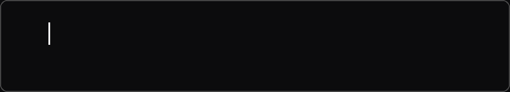
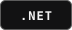
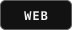
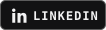
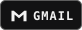

  

  

## Who Am I?

I’m **Arsen Yelashkin**, a full-stack developer focused on **.NET, backend development, and the web**. I build personal projects to learn how an idea becomes a working application.

Working on my own projects has taught me to break problems into smaller pieces and improve features as I go. I enjoy figuring out what happens behind the scenes of a web app and finding simpler ways to organize the code.

<!-- Add a specific project or feature you’ve built and what you did on it. -->

 

## Languages & Tools

  
  
  

## Top Projects

**Your project goes here**

Add a short description of what you built, what it does, and the tools you used.

<!--
Replace the example above with your real project:
- **[Project name](https://github.com/arsyuska/REPOSITORY)** — What it does and what you built.
-->

 

---

<h2 align="center">Connect</h2>

<strong>You can click here</strong>

  
  
  

<!--
When you have your real contact details, replace the three images above with:

-->
